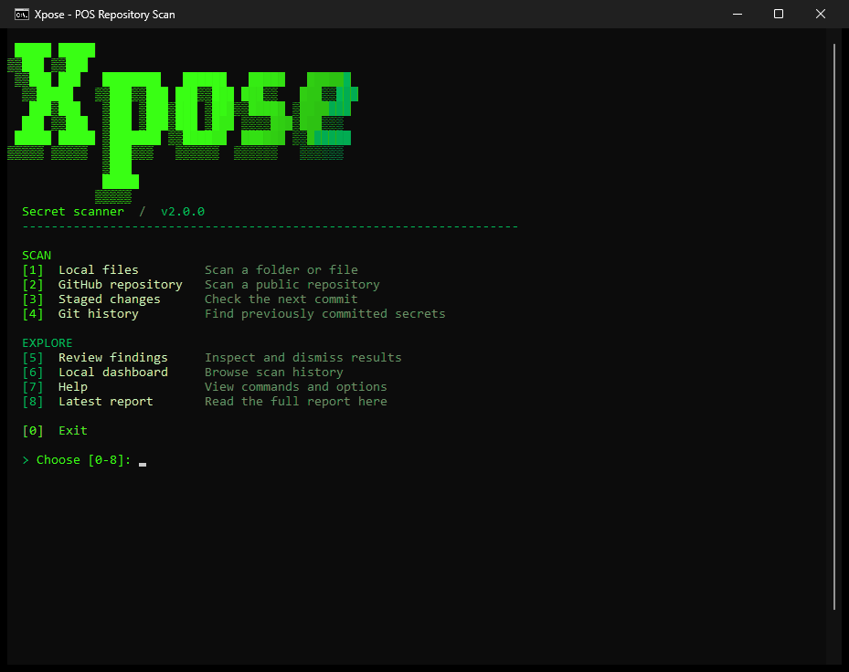
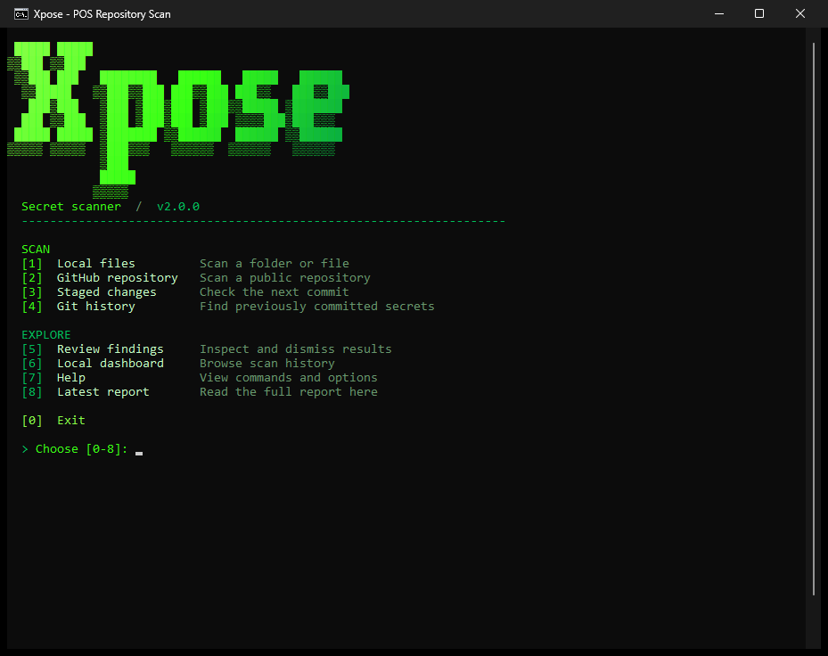
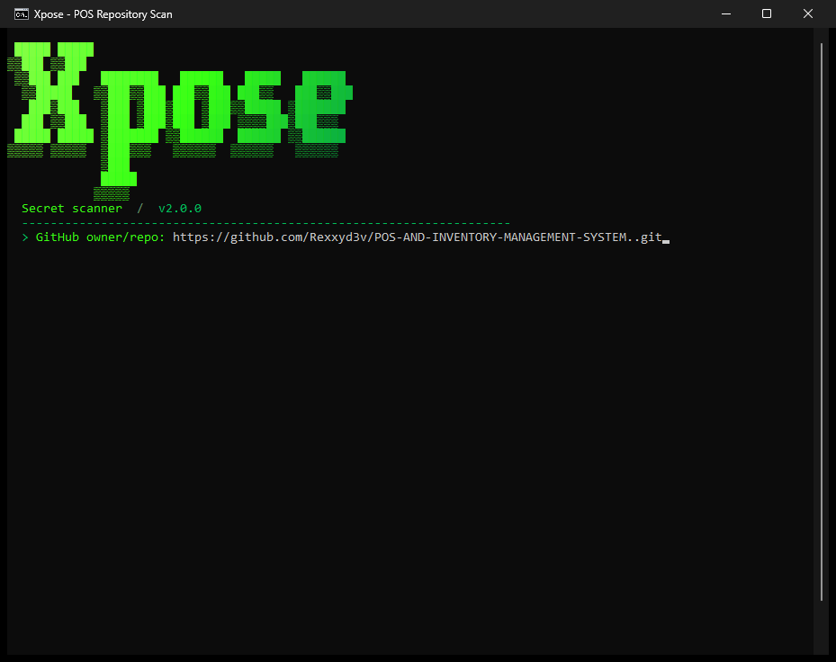
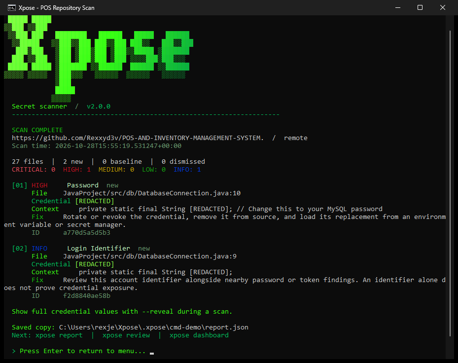
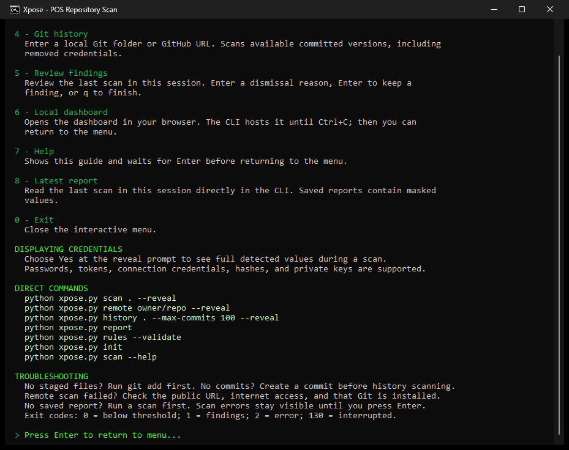

# Xpose

A secret scanner for files, staged Git content, committed history, and public GitHub repositories. Xpose displays complete findings in the CLI, supports explicit credential reveal there, always masks saved findings, and uses only the Python standard library.

## CLI demo

Actual CMD recording of Xpose scanning the [POS and Inventory Management System repository](https://github.com/Rexxyd3v/POS-AND-INVENTORY-MANAGEMENT-SYSTEM..git), displaying the report, and navigating to Help. Credential values are masked; binary build and image files were excluded in the capture workspace.



<details>
<summary><strong>View CMD screenshots</strong></summary>

### Main menu



### GitHub repository input



### Scan report



### Help page



</details>

See the [feature roadmap](FEATURE_ROADMAP.md) for proposed enhancements.

## Requirements and setup

- Python **3.11+** (the configuration loader uses built-in TOML support).
- Git for staged, history, remote, and hook commands.

```sh
python -m pip install .
xpose --help
```

You can also run every command directly with `python xpose.py` without installing anything. Running it without arguments opens the interactive menu when attached to a terminal.

Menu **7 — Help** opens a dedicated guide with instructions for every numbered option, examples, and troubleshooting. It waits for Enter before returning to the menu. You can also open this guide using `python xpose.py help`; `python xpose.py scan --help` shows detailed scan flags.

Within an interactive session, Review, Latest report, and Dashboard follow the most recent scan's target and state directory, even when you scanned a different project folder. Menu errors wait for Enter and return to the menu. The dashboard opens your default browser and runs until Ctrl+C, after which you can return to the menu.

## Quick start

```sh
python xpose.py
python xpose.py scan .
python xpose.py scan path/to/file.env
python xpose.py scan . --reveal
python xpose.py report
python xpose.py remote owner/repo --tree
python xpose.py staged .
python xpose.py history .
```

The CLI uses a hacker-style theme with a neon-to-deep-green block-letter banner, green menu sections and prompts, pale green text, distinct severity colors, context, stable finding IDs, and skipped-file/error details. Every finding is shown by default, including baseline and dismissed entries with their status. Each includes its file/line, credential value (masked by default), context, and remediation. Use `--limit N` to shorten the display, or `--limit 0` for all findings. True-color terminals get a smooth gradient; 256-color and basic ANSI terminals get compatible color fallbacks. Terminals that cannot encode the block letters get an ASCII label. It animates progress in an interactive terminal and automatically uses plain output when redirected. Set `NO_COLOR=1` to disable colors.

Detection covers API keys, quoted/unquoted password assignments, access/refresh/session tokens, client and signing secrets, cloud credentials, Basic/Bearer authorization headers, credential-bearing connection URLs (including database, Redis, FTP, and SMTP), XML password fields, bcrypt/Argon2 password hashes, and complete PEM private-key blocks. Explicit username/email assignments are reported at INFO as account identifiers, not proof of a compromised credential. Weak literal passwords are flagged too; environment references, common code lookups, and obvious placeholders are filtered. In common source-code files (including JavaScript, TypeScript, and Python), generic assignment rules ignore unquoted variable/property expressions whose values reference properties such as `user.email` or `auth.currentUser`. Quoted literals and static backtick strings remain detectable; interpolated templates are skipped. Configuration files retain support for unquoted literal values, including dotted passwords. This is a syntax heuristic, not full program analysis. Formats outside these rules may need custom rules: detection is heuristic, not a guarantee that every credential can be recognized.

To see the actual detected credential values directly in the terminal, add `--reveal` to `scan`, `remote`, `staged`, or `history`. The interactive scan menu also asks whether to show full values; Enter selects Yes. Revealed values are held transiently for display and never added to JSON, HTML, SARIF, baselines, or dashboard history. Explicit `--reveal` also prints values when redirecting CLI output. `--reveal` and `--quiet` cannot be combined.

Choose **8 — Latest report** in the menu, or run `python xpose.py report` to read the latest saved report directly in the CLI. To inspect another JSON report, run `python xpose.py report path/to/report.json`. Saved reports contain masked values; re-scan with `--reveal` to display actual credentials.

All scan commands write a versioned report object to `report.json` and save the latest masked report plus up to 200 run summaries in `.xpose/`. Paths inside findings are relative to the scan root. Ignore `.xpose/` and generated reports in version control. Reports contain masked source context and repository metadata; they are not a substitute for source access controls.

### Exit codes

| Code | Meaning |
| --- | --- |
| 0 | No new findings at or above the configured failure severity |
| 1 | New findings meet the failure severity (default: HIGH) |
| 2 | Invalid configuration, failed operation, or incomplete scan due to unreadable/unsupported text |
| 130 | Interrupted |

Skipped binary, oversized, symlink, and excluded files are outside the configured scope. Oversized and binary files appear in scan reports; exclusions are recorded under `scope`. A completed scan describes that configured scope, not proof that the project contains no secrets.

```sh
python xpose.py scan . --fail-on MEDIUM --exclude '*.min.js'
python xpose.py scan . --min-severity HIGH --limit 10
python xpose.py scan . --max-file-size 5000000 --quiet --no-save
```

`--min-severity` filters console details only. Failure policy and saved reports still consider every finding, so display filtering cannot bypass a CI gate. `--quiet` suppresses routine output; inspect the report and exit code. `--no-save` disables local run history, but still writes the requested output report.

## Project configuration and custom rules

```sh
python xpose.py init
```

The scan target's `.xpose.toml` is loaded automatically. Git modes load it from the repository root. Remote scans use the current workspace configuration, never configuration from the downloaded repository. Other commands use the current directory. Pass `--config path/to/.xpose.toml` to choose an explicit file. Configuration paths resolve relative to the configuration file; explicit CLI paths resolve relative to the current directory.

```toml
exclude = ["vendor/**", "*.min.js"]
fail_on = "HIGH"
min_severity = "INFO"
max_file_size = 2000000
output = "report.json"
format = "json"
state_dir = ".xpose"
# baseline = ".xpose-baseline.json"

[[rules]]
name = "Internal token"
pattern = 'internal_(?P<secret>[A-Za-z0-9]{32})'
severity = "HIGH"
min_entropy = 3.5
remediation = "Rotate the internal credential and load the replacement from the deployment secret store."
```

Custom rules extend the built-ins. Each needs a unique name (or `id`), regex, and severity: INFO, LOW, MEDIUM, HIGH, or CRITICAL. Use `(?P<secret>...)` or `secret_group` to isolate the credential for entropy and fingerprinting. `min_entropy` is 0–8 bits per character and should be calibrated per rule. Built-ins suppress obvious placeholders, avoid credential-free database URLs, and prefer specific provider detections over overlapping generic detections.

Exclusions are case-sensitive relative glob patterns with forward slashes. A bare name/pattern matches path components; a directory pattern also excludes its descendants. This is not a full `.gitignore` parser: negation/re-inclusion is unsupported. Built-in exclusions cover `.git`, `.venv`, dependencies, build output, `.xpose`, and standard report/baseline names. Custom output, baseline, and state paths inside the scan root are excluded automatically.

## Git workflows

```sh
python xpose.py staged .
python xpose.py history . --revision main
python xpose.py history . --revision 'main~10..main'
python xpose.py history . --max-commits 100
python xpose.py remote owner/repo --history
```

Explicit GitHub URLs also work as targets for `scan` and `history`, including in the interactive menu: `python xpose.py history https://github.com/owner/repo.git --reveal` automatically selects a remote history scan. Staged scans require a local repository folder because uncommitted staged changes do not exist on GitHub.

Staged scans read changed files from the Git index, including an initial commit. They inspect the entire staged file; an older secret elsewhere in a changed file can still block the commit. Unstaged edits cannot hide staged credentials. Matching supports multiline rules, including complete private-key blocks; findings retain their original start line. Incomplete private-key opening markers are also reported.

History scans inspect committed snapshots and deduplicate identical findings by path, rule, and credential fingerprint. The recorded commit is a representative matching snapshot encountered newest-first, **not** a claim about the introducing commit. `--max-commits` limits scope and is recorded in the report. Local shallow repositories only contain their available history. Git mode skips symlinks and submodules; submodules must be scanned separately.

Remote scans support public GitHub repositories using HTTPS, SSH-style GitHub URLs, or `owner/repo`. Working-tree mode uses a shallow clone; `--history` fetches full available branch history. Repositories are cloned without checkout and scanned as Git objects. Temporary clones are cleaned up on success and failure. Remote configuration and hooks are not executed.

### Pre-commit prevention

To install a hook in your own repository:

```sh
python xpose.py hook --path .
```

Existing hooks are preserved: integrate `xpose staged --no-save --output .xpose/pre-commit.json` manually when a hook already exists. The generated hook references the current Python interpreter and this checkout, so reinstall it after moving either. It blocks on findings at the configured threshold or scan errors.

Alternatively, after publishing this version, use this repository's `.pre-commit-hooks.yaml` with your chosen revision in a pre-commit configuration. The hook installs the package and receives no filename arguments.

## Baselines and review

Review findings before accepting existing exposure:

```sh
python xpose.py review
python xpose.py review --severity HIGH --search config
python xpose.py review --id FINDING_ID_PREFIX --reason "Reviewed synthetic fixture"
python xpose.py review --id FINDING_ID_PREFIX --restore
python xpose.py baseline report.json --output .xpose-baseline.json
python xpose.py scan . --baseline .xpose-baseline.json
```

Interactive review shows masked context and remediation advice. Enter a reason to dismiss a finding, Enter to keep it, or `q` to finish. Noninteractive dismissal requires an unambiguous ID prefix and `--reason`. Re-scan after changing suppressions to refresh reports and the dashboard.

Baselines contain IDs and timestamps, never raw credentials. IDs are derived from relative path, rule ID, and a SHA-256 credential digest, so line shifts do not reintroduce findings; renaming files or changing credentials does. IDs can still reveal equality and allow guessing of weak values, so protect baseline/state files. Suppressions are stored locally in `.xpose/suppressions.json`; share a reviewed baseline or an explicitly managed state directory for CI. Baseline generation requires a complete scan report and refuses to overwrite an existing baseline. Baselines/dismissals affect future failure decisions, not the underlying source.

## Reports and remediation

```sh
python xpose.py scan . --format html --output report.html
python xpose.py scan . --format sarif --output report.sarif
python xpose.py scan . --format json --output report.json
```

JSON includes findings, fingerprints, statuses, masked context, scan scope, skipped files, errors, and severity totals. HTML is a standalone report with remediation details and no external assets. SARIF 2.1.0 includes relative encoded paths, rule metadata, fingerprints, suppression reasons, and scan completeness for code-scanning consumers.

Saved credentials are fully masked. `--reveal` displays the actual matched credential in CLI output only. Masking covers matched regions, not arbitrary undetected content. Treat any real credential exposure as a rotation/revocation task: removing a line alone does not invalidate a credential. Xpose provides guidance, not automatic credential revocation or history rewriting.

The included CI workflow tests Python 3.11/3.14 on Windows/Linux, scans the checkout, and saves SARIF artifacts. To display alerts in GitHub code scanning on an eligible repository, add `github/codeql-action/upload-sarif` with `sarif_file: report.sarif` and the required `security-events: write` permission. See [GitHub SARIF integration](https://docs.github.com/en/code-security/how-tos/find-and-fix-code-vulnerabilities/integrate-with-existing-tools/upload-sarif-file).

## Rule playground

```sh
python xpose.py rules --validate
python xpose.py test-rule --pattern 'internal_(?P<secret>[A-Za-z0-9]{32})' --file sample.txt --min-entropy 3.5
```

Without `--file`, the playground reads stdin. Results show only masked matches. Rules execute Python regular expressions; use trusted rule files and avoid expressions with excessive backtracking. Detection remains heuristic and provider formats can change.

## Local dashboard

```sh
python xpose.py dashboard
python xpose.py dashboard --port 9000
python xpose.py runs
```

Open `http://127.0.0.1:8765` for the latest scan, new/baseline/dismissed counts, severity and text filters, masked findings, and recent run history. The server binds to loopback and is read-only. Refresh to load new scans; Ctrl+C stops it. History counts reflect each run's scope and target, so compare matching scans when judging trends. Findings shown are from the latest run, not a cross-repository issue tracker.

## Development

```sh
python -m unittest discover -s tests -v
python xpose.py rules --validate
```

Tests construct synthetic credentials in temporary directories and cover masking, stable IDs, false positives, entropy thresholds, configuration failures, Git index/history behavior, hooks, baselines, suppressions, HTML/SARIF, and clone cleanup.
